<!-- markdownlint-disable MD033 MD041 -->
<p align="center">
  <picture>
    <source media="(prefers-color-scheme: dark)" srcset="assets/logo-dark.svg" />
    
  </picture>
</p>

<p align="center">
  <b>English</b> · <a href="README.zh-CN.md">简体中文</a>
</p>

<p align="center">
  <strong>Your music, played the way it was made.</strong>
  <br />
  A desktop music player for the files you already own — for Windows, macOS and Linux.
</p>

<p align="center">
  
  
  
  
  
  
  
  
</p>

<p align="center">
  WaveFlow scans your folders, organizes everything by album, artist and genre, and plays it through its own
  real-time audio engine — gapless, Hi-Res, bit-perfect when you ask for it, with lyrics that follow every word.
  <br />
  No subscription, no streaming service, no account.
  <br />
  <strong>Your files. Your library. Your machine.</strong>
</p>

<p align="center">
  <a href="https://github.com/InstaZDLL/WaveFlow/releases/latest"></a>
</p>

<p align="center">
  <a href="#install"><b>Install</b></a>
  &nbsp;·&nbsp;
  <a href="#features"><b>Features</b></a>
  &nbsp;·&nbsp;
  <a href="#extend-waveflow"><b>Plugins</b></a>
  &nbsp;·&nbsp;
  <a href="#screenshots"><b>Screenshots</b></a>
  &nbsp;·&nbsp;
  <a href="#the-waveflow-family"><b>Server &amp; QuickPlay</b></a>
  &nbsp;·&nbsp;
  <a href="docs/README.md"><b>Documentation</b></a>
</p>

<p align="center">
  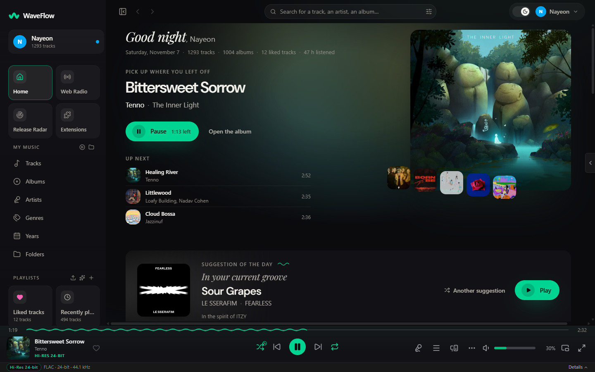
  <br />
  <sub><b>Fluid</b>, the 2.0 interface · pick up where you left off, what plays next, the suggestion of the day</sub>
</p>

---

## Why WaveFlow

<table>
  <tr>
    <td width="50%" valign="top">
      <h3>🎚️ An engine built for your DAC</h3>
      <b>Exclusive output on Windows, macOS and Linux.</b> DSD sent untouched over DoP, 5.1 and 7.1 played on the speakers they name, and a real two-decoder crossfade — <b>AutoMix</b> lines the next track's beats up with the one playing.
      <br /><a href="docs/features/playback.md">How playback works →</a>
    </td>
    <td width="50%" valign="top">
      <h3>🎤 Lyrics that follow every word</h3>
      <b>Karaoke timing, word by word</b>, with romanization under Japanese, Korean and Chinese lines and translations beside the original — in the immersive view, the mini-player, and a floating line above every window.
      <br /><a href="docs/features/integrations.md">Lyrics sources →</a>
    </td>
  </tr>
  <tr>
    <td width="50%" valign="top">
      <h3>🔍 A library that reads the music, not just the tags</h3>
      <b>Tempo, key and loudness measured</b>, files sold as lossless that are not spotted, gaps filled from MusicBrainz without touching a file, and a tag workshop whose every change can be undone.
      <br /><a href="docs/features/enrichment.md">Enrichment →</a> · <a href="docs/features/tag-workshop.md">Tag workshop →</a>
    </td>
    <td width="50%" valign="top">
      <h3>🎨 Six identities, and room to grow</h3>
      <b>Six skins that are layouts, not palettes</b>, Canvas clips and animated covers behind the track, and sandboxed plugins installed in one click from a store that checks every download.
      <br /><a href="#extend-waveflow">Plugins →</a> · <a href="#six-skins">Skins →</a>
    </td>
  </tr>
</table>

<p align="center"><sub>Also inside: podcasts · smart playlists and Daily Mix · WebDAV and SMB shares · DLNA and MPD servers · statistics and Wrapped · 17 languages · a library per profile</sub></p>

## Music you can see

Word-synced lyrics with romanization and translations, the track's Canvas clip or animated cover, a spectrum that moves with the sound — all in the player, nothing in a browser tab.

<p align="center">
  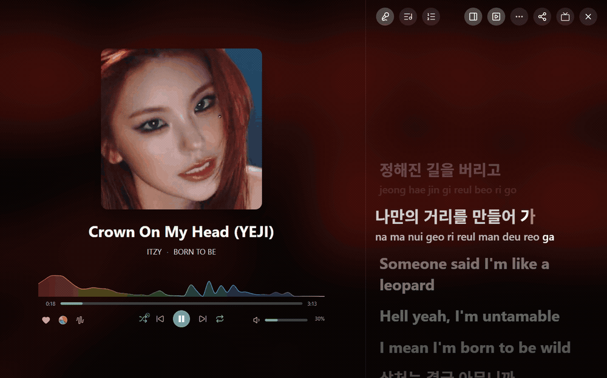
</p>

## Install

Download the package for your system from the [latest release](https://github.com/InstaZDLL/WaveFlow/releases/latest). Every release page lists the one-liner for your package manager (AUR, COPR, apt, winget) and the standalone installers for Windows, macOS and Linux. Installed builds update themselves, and a beta channel can be switched on in Settings.

## Features

The essentials of each area; every heading links to its full description.

### 🎧 [Playback](docs/features/playback.md)

- MP3, FLAC, WAV, AIFF, Ogg Vorbis, Opus, AAC (HE-AAC included), ALAC, WavPack, Monkey's Audio and DSD
- Gapless, and a crossfade that can be fixed, album-aware, tempo-aware or **AutoMix**, on the beats
- **Exclusive output** and **DSD over PCM**, **5.1 / 7.1** on the right speakers or mixed down to what you have
- ReplayGain, 6-band EQ, speed with or without keeping the pitch, transposition, A-B repeat, sleep timer

### 🎤 [Lyrics](docs/features/integrations.md)

- Synced lyrics from LRCLIB and other providers, from a [plugin](#extend-waveflow), or from a `.lrc` / `.ttml` file next to the track
- Word-by-word timing, estimated when a source only has lines
- Romanization for Japanese, Korean and Chinese, and translations beside the original

### 📚 [Library](docs/features/library.md)

- Folder scan with a live watcher, and **WebDAV and SMB shares** read as library folders
- Browse by album, artist, genre, year or folder; search with pinyin for Chinese titles
- A **Quality** tab that spots fake lossless, duplicates, album completeness, and a file replaced by a better copy without losing its plays, likes and playlists

### 🏷️ [Tags & enrichment](docs/features/enrichment.md)

- **MusicBrainz** fills genres, dates, credits and covers in your library — reviewed, undoable, never written into your files
- A [**tag workshop**](docs/features/tag-workshop.md) for a selection, an album or a folder: fill, find and replace (regex included), case, numbering, with a field-by-field preview and an undo

### 🎶 [Playlists](docs/features/playlists.md)

- [Smart playlists](docs/features/smart-playlists.md) built from rules, with a live count
- **Daily Mix** and **On Repeat** made from what you play, and **Release Radar** for your artists' new releases
- Import from M3U, CSV, JSON or a public Deezer link — the tracks you do not have yet keep their place

### 🎙️ [Podcasts](docs/features/podcasts.md)

- Opt-in and kept apart from your music: subscriptions, OPML, a refresh timer, downloads under a size limit
- Resume where you stopped, each show at its own speed, chapters and transcripts

### 🎨 [Interface](docs/features/ui.md)

- Six skins and fourteen themes, an accent of your own or taken from the cover
- Immersive view, always-on-top mini-player, a floating desktop lyrics line, system tray
- Statistics and **WaveFlow Wrapped**, all computed on your machine; 17 languages, right-to-left included

### 🔌 [Connections](docs/features/integrations.md)

- Last.fm scrobbling, Discord Rich Presence, artwork and biographies fetched once and cached
- Optional [DLNA / UPnP](docs/features/dlna.md) and [MPD](docs/features/mpd.md) servers for the clients you already use
- Your own [WaveFlow Server](#the-waveflow-family) as a second source, synced across devices
- An offline switch that cuts all network access

## Extend WaveFlow

Plugins are small WebAssembly modules that run in a sandbox, with only the permissions they ask for. The store inside WaveFlow installs them in one click, and checks every download against the fingerprint its [registry](https://github.com/InstaZDLL/waveflow-plugins) pins.

<table>
  <tr>
    <td width="50%" valign="top">
      <b>📻 Web Radio</b> · <i>built in</i>
      <br />
      30 000+ stations by country, language or genre, a 30-minute pause buffer on live streams, HLS, and stations of your own.
    </td>
    <td width="50%" valign="top">
      <b>🎤 Word-synced lyrics</b> · <i>five sources</i>
      <br />
      More catalogues with word timing, background vocals and duets, translations and romanization — strong on Chinese, Japanese and Korean music.
    </td>
  </tr>
  <tr>
    <td width="50%" valign="top">
      <b>🎞️ Motion on Now Playing</b> · <i>three sources</i>
      <br />
      Looping Canvas clips and animated album covers, played behind the track in the immersive view and the side panel.
    </td>
    <td width="50%" valign="top">
      <b>🛠️ Your own</b>
      <br />
      Four kinds to write: music sources, metadata and lyrics, pages of their own, Canvas clips. Any language that builds a WebAssembly component will do.
    </td>
  </tr>
</table>

<p align="center">
  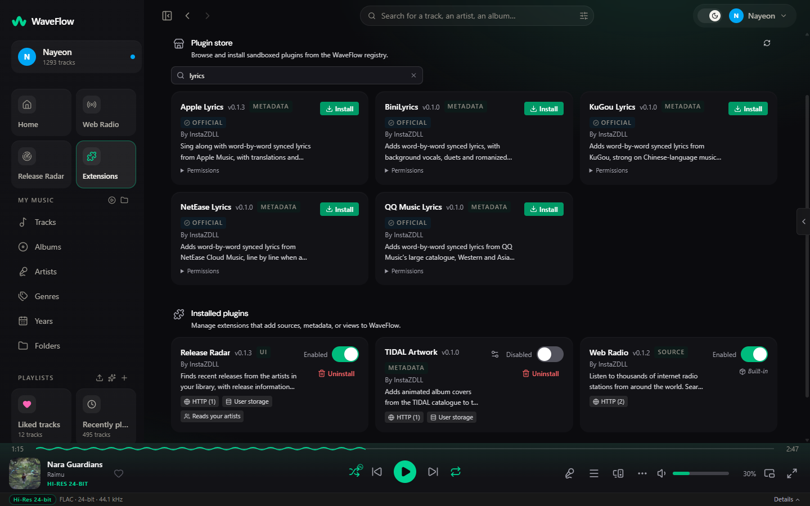
  <br />
  <sub>Want to write one? Start with the <a href="docs/features/plugins.md">plugin guide</a> and <a href="docs/rfcs/RFC-002-plugin-sdk.md">RFC-002</a>.</sub>
</p>

## Screenshots

<table>
  <tr>
    <td width="50%">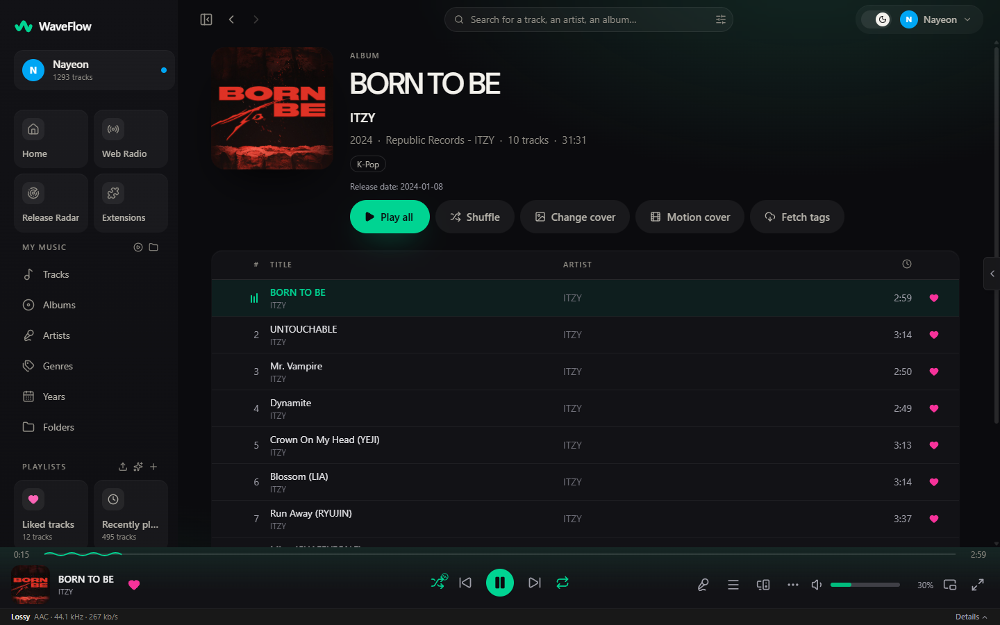</td>
    <td width="50%">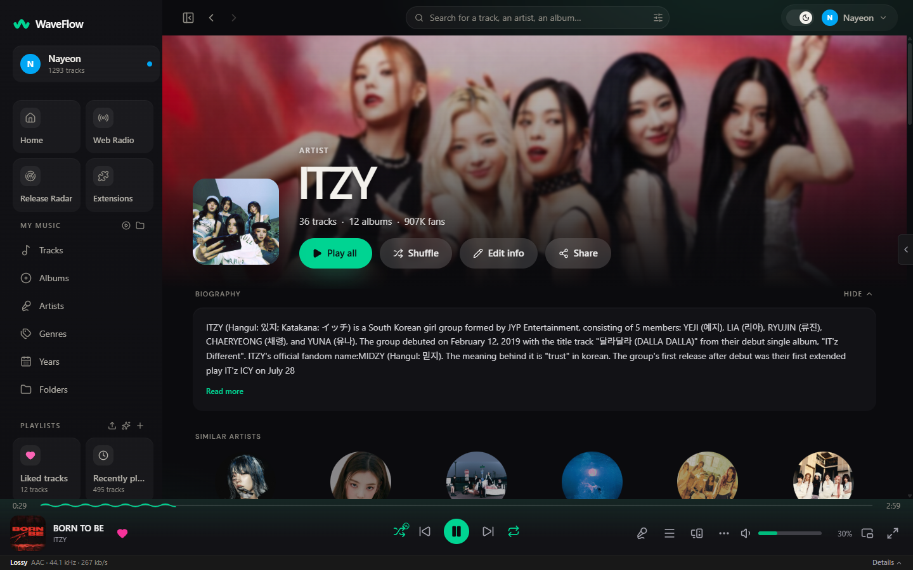</td>
  </tr>
  <tr>
    <td align="center"><sub><b>Album</b> · the track playing, Hi-Res quality in the player bar</sub></td>
    <td align="center"><sub><b>Artist</b> · a banner, the biography, similar artists</sub></td>
  </tr>
  <tr>
    <td width="50%">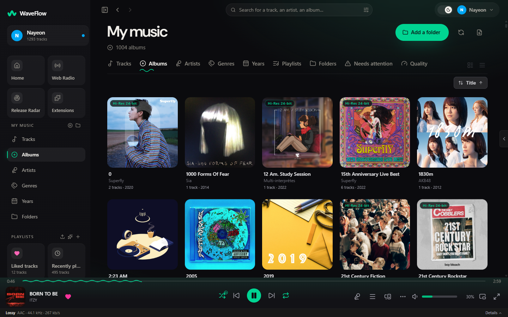</td>
    <td width="50%">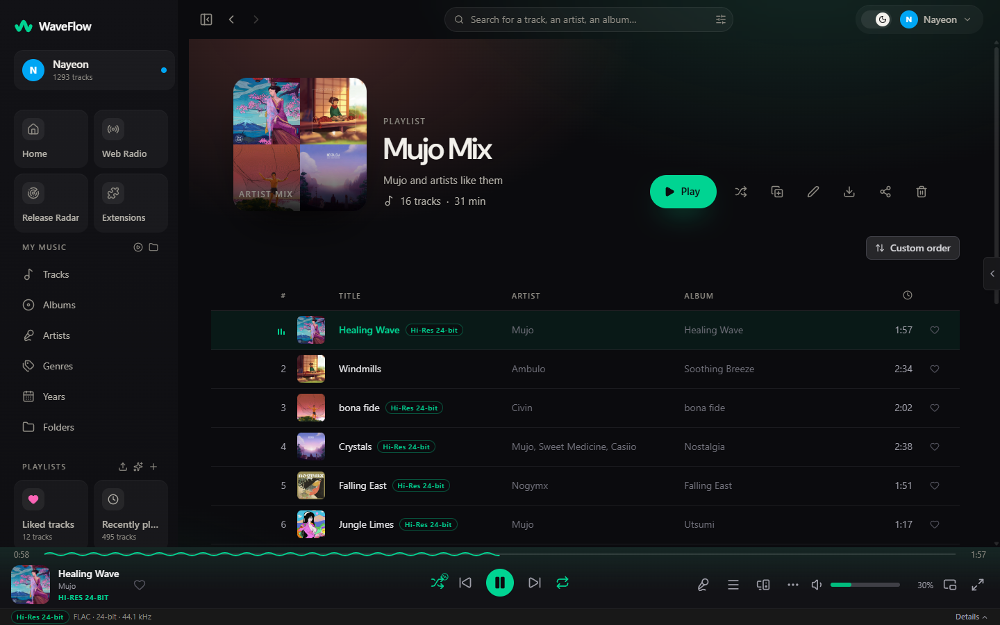</td>
  </tr>
  <tr>
    <td align="center"><sub><b>Library</b> · albums, artists, genres, years, folders, quality</sub></td>
    <td align="center"><sub><b>Smart playlist</b> · made from what you play</sub></td>
  </tr>
  <tr>
    <td width="50%">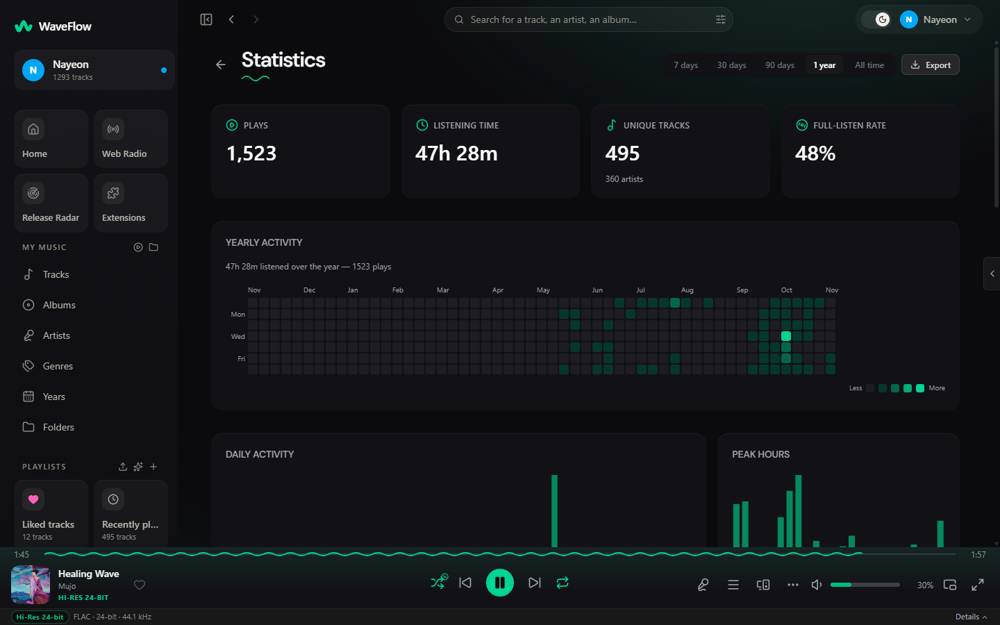</td>
    <td width="50%">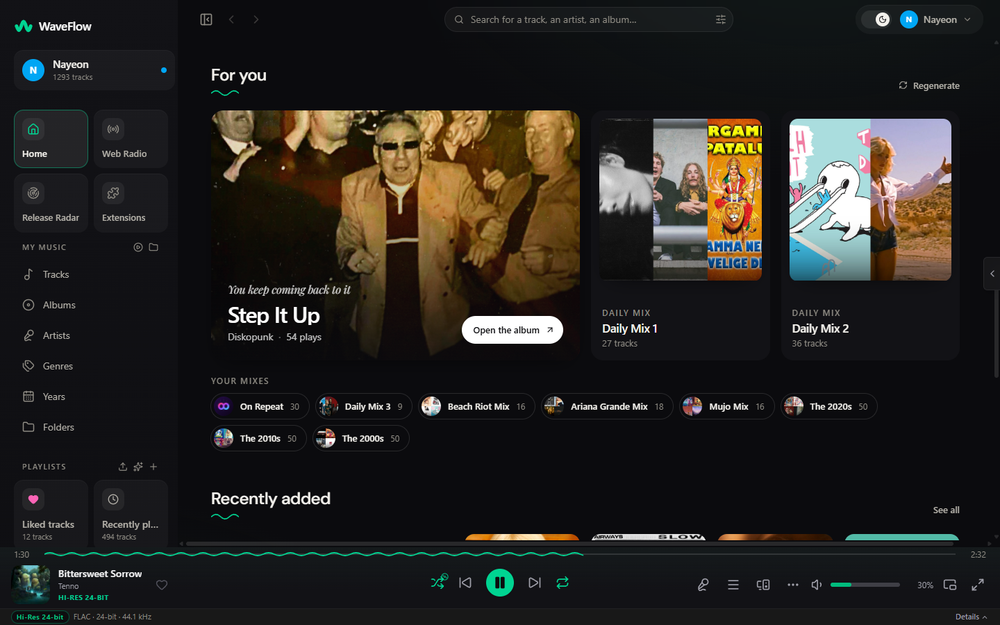</td>
  </tr>
  <tr>
    <td align="center"><sub><b>Statistics</b> · all computed on your machine</sub></td>
    <td align="center"><sub><b>For you</b> · Daily Mix, On Repeat, your own mixes</sub></td>
  </tr>
</table>

### Beyond the player

<table>
  <tr>
    <td width="50%" align="center">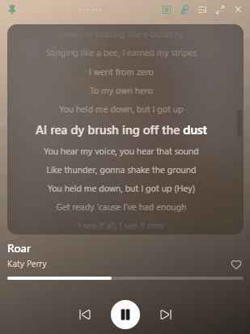</td>
    <td width="50%" align="center">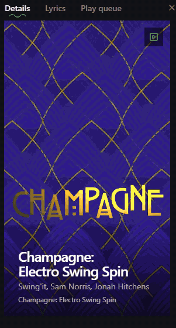</td>
  </tr>
  <tr>
    <td align="center"><sub><b>Mini-player</b> · always on top, word-synced lyrics</sub></td>
    <td align="center"><sub><b>Now Playing</b> · the Canvas clip in place of the cover</sub></td>
  </tr>
  <tr>
    <td width="50%">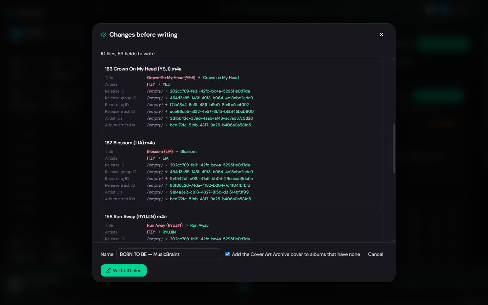</td>
    <td width="50%">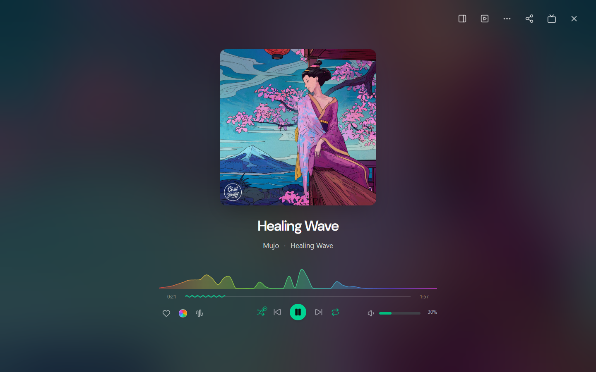</td>
  </tr>
  <tr>
    <td align="center"><sub><b>Tag workshop</b> · every change previewed, every change undoable</sub></td>
    <td align="center"><sub><b>Immersive view</b> · the cover and a live spectrum</sub></td>
  </tr>
</table>

### Six skins

Not six palettes: six layouts, each with its own type, materials and motion. The same page, the same moment, in each of them.

<p align="center">
  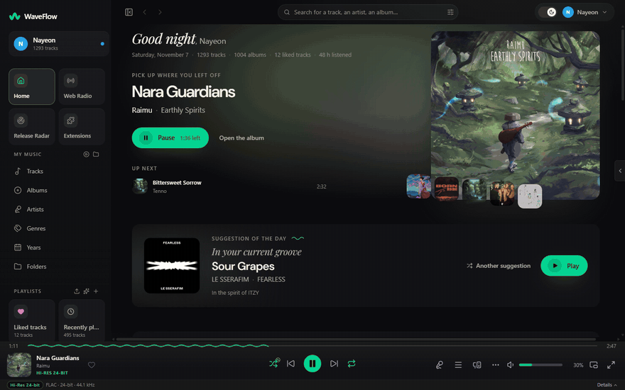
</p>

<table>
  <tr>
    <td width="33%">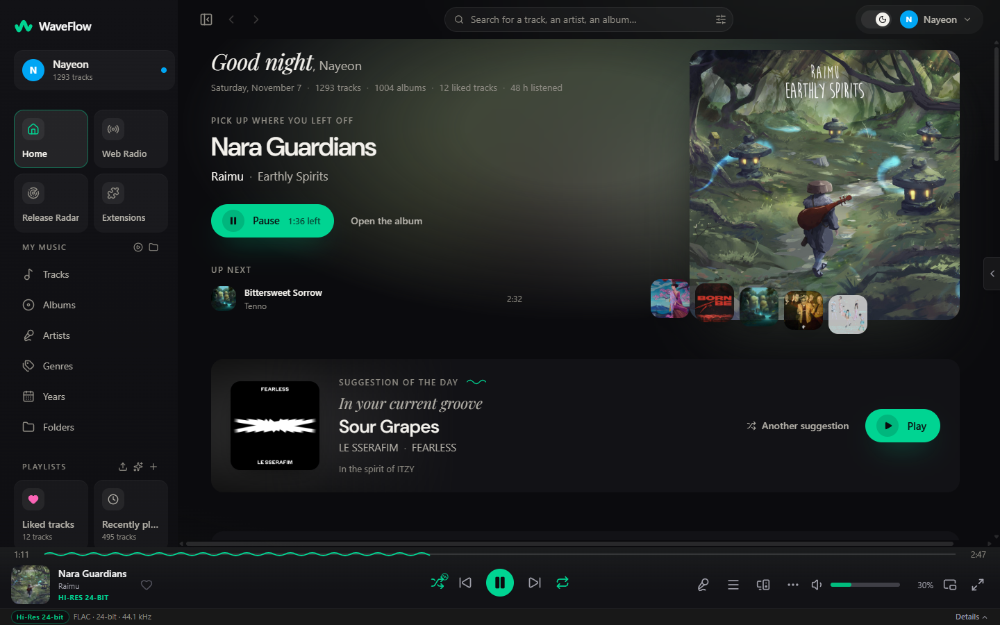</td>
    <td width="33%">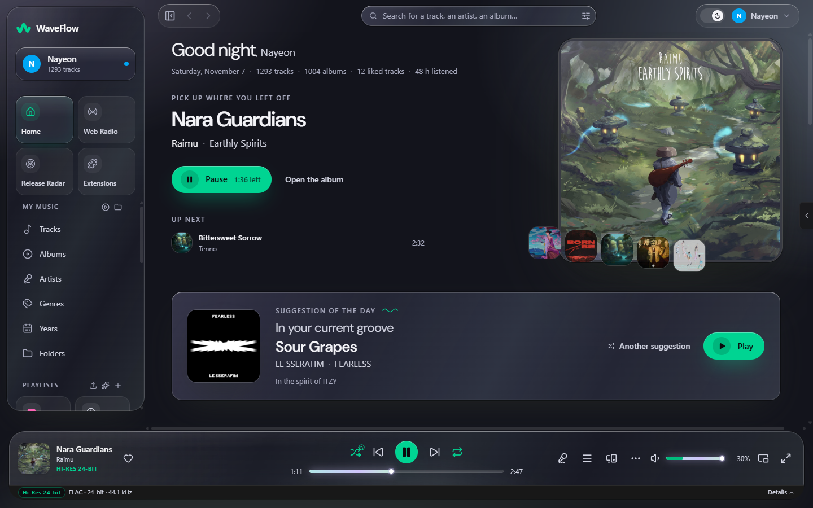</td>
    <td width="33%">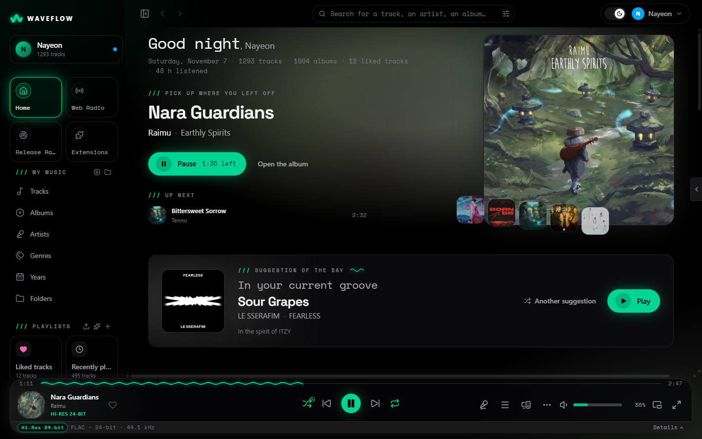</td>
  </tr>
  <tr>
    <td align="center"><sub><b>Fluid</b> · the default</sub></td>
    <td align="center"><sub><b>Liquid</b> · aurora glass</sub></td>
    <td align="center"><sub><b>Pulse</b> · neon deck</sub></td>
  </tr>
  <tr>
    <td width="33%">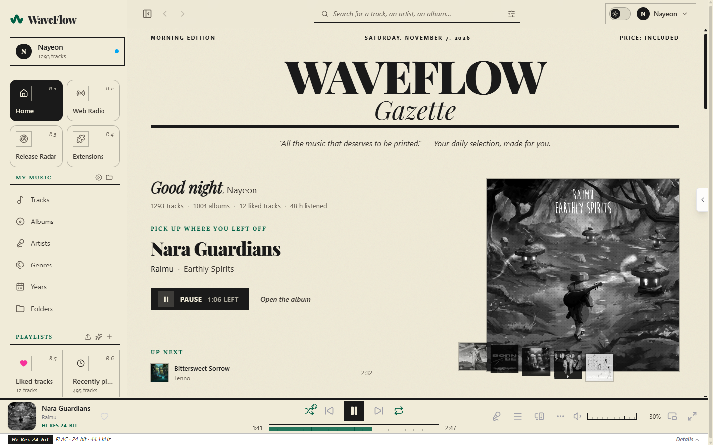</td>
    <td width="33%">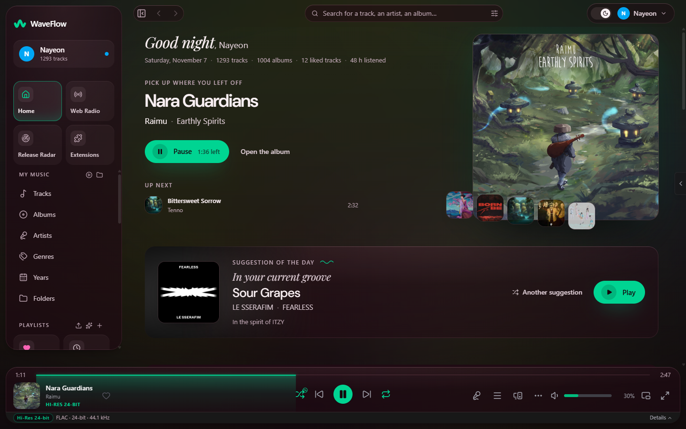</td>
    <td width="33%">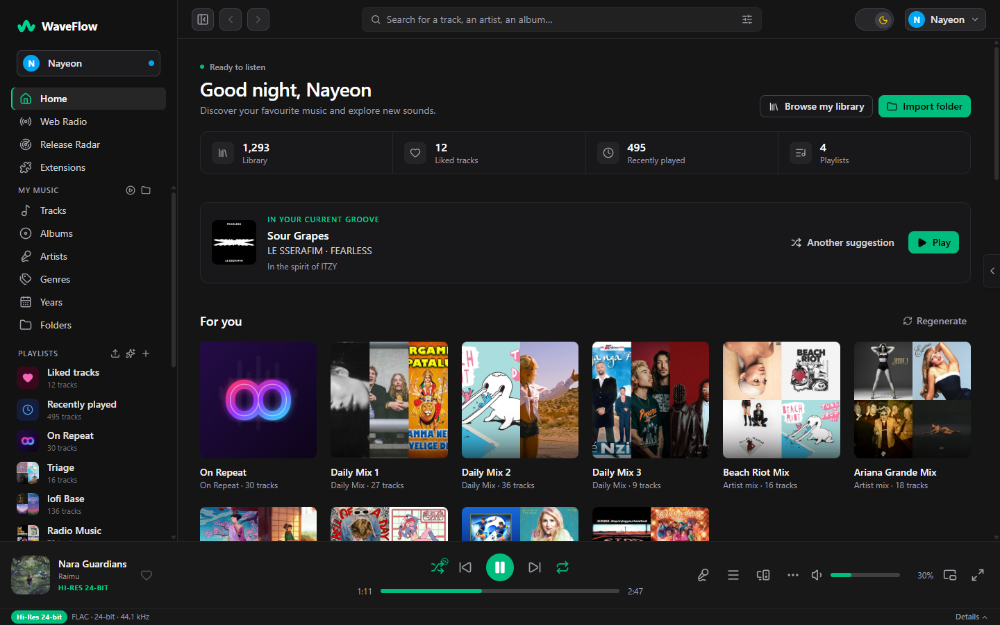</td>
  </tr>
  <tr>
    <td align="center"><sub><b>Editorial</b> · broadsheet on paper</sub></td>
    <td align="center"><sub><b>Lounge</b> · listening room</sub></td>
    <td align="center"><sub><b>Studio</b> · the classic layout</sub></td>
  </tr>
</table>

<p align="center"><sub><i>Album artwork shown in the screenshots comes from the maintainer's own library and belongs to its respective rights holders. WaveFlow does not bundle or distribute any music.</i></sub></p>

## The WaveFlow family

WaveFlow is the centre of a small family of free, open-source apps that share its engine and its look.

<table>
  <tr>
    <td width="50%" valign="top">
      <a href="https://github.com/InstaZDLL/waveflow-server"></a>
      <br />
      <b><a href="https://github.com/InstaZDLL/waveflow-server">🌐 WaveFlow Server</a></b>
      <br />
      <i>Your music, everywhere you listen.</i> A self-hosted music server in one Rust binary, with a web player built in and the OpenSubsonic API your phone apps already speak. Point WaveFlow at it and its catalogue joins your library; favourites, ratings and playlists follow you from one device to the next.
      <br />
      <a href="https://github.com/InstaZDLL/waveflow-server#install"><b>Install the server →</b></a>
    </td>
    <td width="50%" valign="top">
      <a href="https://github.com/InstaZDLL/waveflow-quickplay"></a>
      <br />
      <b><a href="https://github.com/InstaZDLL/waveflow-quickplay">⚡ WaveFlow QuickPlay</a></b>
      <br />
      <i>Double-click. Just listen.</i> A small native player for the file in front of you: up in under 300 ms from the file manager, with no library to scan. Same decoders as WaveFlow — FLAC, Opus, DSD and the rest — with synced lyrics, the cover and a playlist.
      <br />
      <a href="https://github.com/InstaZDLL/waveflow-quickplay/releases/latest"><b>Download QuickPlay →</b></a>
    </td>
  </tr>
</table>

- **[WaveFlow for Android](https://github.com/InstaZDLL/waveflow-android)** — the native mobile client, in development.
- **[waveflow-plugins](https://github.com/InstaZDLL/waveflow-plugins)** — the curated registry the in-app plugin store reads.

## Development

Requires Bun, Rust and the platform dependencies listed in the [developer guide](docs/CONTRIBUTING.md#requirements).

```bash
bun install            # dependencies
bun run tauri dev      # the desktop app in development mode
bun run tauri build    # a production bundle

bun run dev            # Vite dev server only (no Tauri shell)
bun run typecheck      # TypeScript check
bun run lint           # ESLint
bun run format         # Prettier

# Rust backend
cargo fmt   --manifest-path src-tauri/Cargo.toml --all -- --check   # CI runs it first
cargo check --manifest-path src-tauri/Cargo.toml --workspace --all-targets
cargo test  --manifest-path src-tauri/Cargo.toml --workspace
```

**Tech stack** — Tauri 2 · Rust · SQLite (sqlx, FTS5) · tokio · React 19 · TypeScript · Vite · Tailwind CSS 4 · Framer Motion · symphonia + libopus + rusty_aac (decoding) · cpal (output) · rubato (resampling) · rtrb (lock-free ring buffer) · realfft (spectrum) · lofty (tags) · wasmtime + WASI p2 (plugins).

## Documentation

Every feature in detail, the architecture and the storage layout live under [`docs/`](docs/README.md):

- **Features** — [playback](docs/features/playback.md) · [library](docs/features/library.md) · [enrichment](docs/features/enrichment.md) · [tag workshop](docs/features/tag-workshop.md) · [playlists](docs/features/playlists.md) · [smart playlists](docs/features/smart-playlists.md) · [podcasts](docs/features/podcasts.md) · [integrations](docs/features/integrations.md) · [plugins](docs/features/plugins.md) · [DLNA / UPnP](docs/features/dlna.md) · [MPD](docs/features/mpd.md) · [UI & UX](docs/features/ui.md)
- **Design** — [Fluid Editorial](docs/design/fluid-editorial.md) · [Liquid](docs/design/liquid-aurora-glass.md) · [Pulse](docs/design/pulse-neon-deck.md) · [Editorial](docs/design/editorial-broadsheet.md) · [Lounge](docs/design/lounge-listening-room.md) · [Studio](docs/design/studio-refined.md)
- **Architecture** — [cross-cutting invariants](docs/architecture/invariants.md) · [crate layout](docs/architecture/crates.md) · [audio engine](docs/architecture/audio.md) · [database & paths](docs/architecture/storage.md)
- **Contributing** — [CONTRIBUTING.md](CONTRIBUTING.md) · [developer guide](docs/CONTRIBUTING.md) · [RELEASING.md](docs/RELEASING.md)

## Community

- 🐛 **Bug?** → [Bug report](https://github.com/InstaZDLL/WaveFlow/issues/new?template=bug_report.yml)
- ✨ **Feature idea?** → [Discussions › Ideas](https://github.com/InstaZDLL/WaveFlow/discussions/categories/ideas) (chat first, graduate to a [feature request issue](https://github.com/InstaZDLL/WaveFlow/issues/new?template=feature_request.yml) once shape is clear)
- 🙏 **Setup help / how-to?** → [Discussions › Q&A](https://github.com/InstaZDLL/WaveFlow/discussions/categories/q-a)
- 🙌 **Show off your setup or playlist?** → [Discussions › Show and tell](https://github.com/InstaZDLL/WaveFlow/discussions/categories/show-and-tell)
- 🔒 **Security?** → [Private disclosure](.github/SECURITY.md) — never post vulnerabilities publicly.

English and French both welcome.

## License

```
Copyright (C) 2026 InstaZDLL

This program is free software: you can redistribute it and/or modify
it under the terms of the GNU General Public License as published by
the Free Software Foundation, version 3 of the License only.

This program is distributed in the hope that it will be useful,
but WITHOUT ANY WARRANTY; without even the implied warranty of
MERCHANTABILITY or FITNESS FOR A PARTICULAR PURPOSE. See the
GNU General Public License for more details.

You should have received a copy of the GNU General Public License
along with this program. If not, see <https://www.gnu.org/licenses/>.
```

See [LICENSE](LICENSE) for the full text. Third-party notices are listed in
[THIRD_PARTY_NOTICES.md](THIRD_PARTY_NOTICES.md).
