<!-- markdownlint-disable MD033 MD041 -->
<p align="center">
  <picture>
    <source media="(prefers-color-scheme: dark)" srcset="assets/logo-dark.svg" />
    
  </picture>
</p>

<p align="center">
  <a href="README.md">English</a> · <b>简体中文</b>
</p>

<p align="center">
  <strong>让你的音乐，以它被创作时的样子播放。</strong>
  <br />
  一款为你已拥有的音频文件而生的桌面音乐播放器，支持 Windows、macOS 和 Linux。
</p>

<p align="center">
  
  
  
  
  
  
  
  
</p>

<p align="center">
  WaveFlow 会扫描你的文件夹，按专辑、艺人和流派整理好一切，并通过自研的实时音频引擎播放：
  无缝衔接、支持 Hi-Res，需要时比特完美输出，歌词逐字跟随。
  <br />
  无需订阅，无需流媒体服务，无需账号。
  <br />
  <strong>你的文件。你的曲库。你的电脑。</strong>
</p>

<p align="center">
  <a href="https://github.com/InstaZDLL/WaveFlow/releases/latest"></a>
</p>

<p align="center">
  <a href="#安装"><b>安装</b></a>
  &nbsp;·&nbsp;
  <a href="#功能"><b>功能</b></a>
  &nbsp;·&nbsp;
  <a href="#扩展-waveflow"><b>插件</b></a>
  &nbsp;·&nbsp;
  <a href="#截图"><b>截图</b></a>
  &nbsp;·&nbsp;
  <a href="#waveflow-家族"><b>Server 与 QuickPlay</b></a>
  &nbsp;·&nbsp;
  <a href="docs/README.md"><b>文档（英文）</b></a>
</p>

<p align="center">
  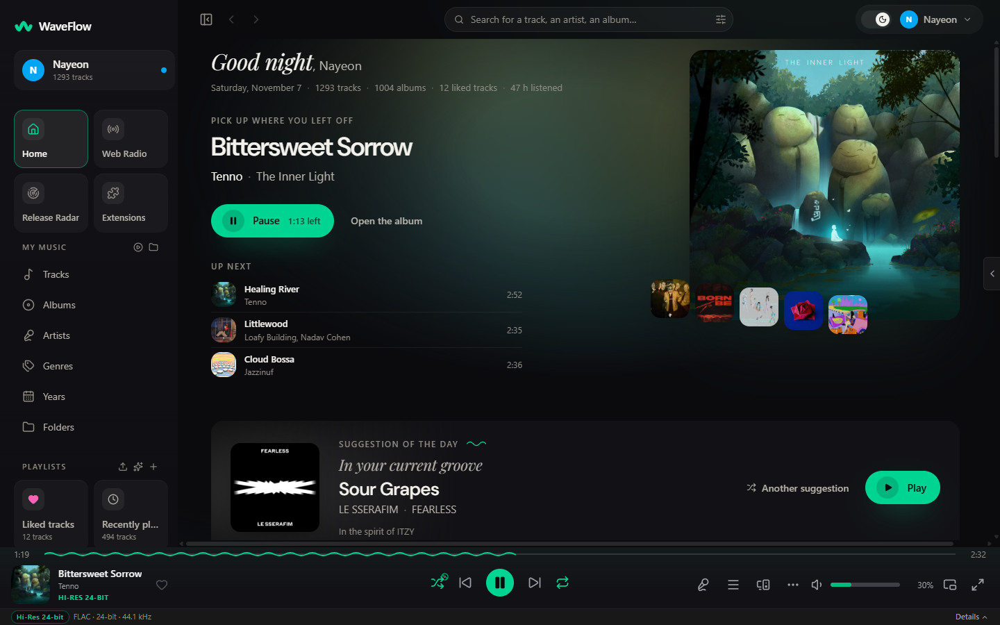
  <br />
  <sub><b>Fluid</b>，2.0 的全新界面 · 从上次停下的地方继续、接下来播放的曲目、今日推荐</sub>
</p>

---

## 为什么选择 WaveFlow

<table>
  <tr>
    <td width="50%" valign="top">
      <h3>🎚️ 为你的 DAC 打造的引擎</h3>
      <b>Windows、macOS 和 Linux 均支持独占输出。</b>DSD 通过 DoP 原样送达，5.1 与 7.1 声道按其标注的扬声器播放，还有真正的双解码器交叉淡入淡出——<b>AutoMix</b> 会让下一首的节拍与正在播放的曲目对齐。
      <br /><a href="docs/features/playback.md">播放原理 →</a>
    </td>
    <td width="50%" valign="top">
      <h3>🎤 逐字跟随的歌词</h3>
      <b>卡拉 OK 式逐字时间轴</b>，日语、韩语和中文歌词下方标注罗马音，原文旁并排显示翻译——在沉浸视图、迷你播放器中都能看到，还有悬浮在所有窗口之上的桌面歌词。
      <br /><a href="docs/features/integrations.md">歌词来源 →</a>
    </td>
  </tr>
  <tr>
    <td width="50%" valign="top">
      <h3>🔍 读懂音乐本身，而不只是标签</h3>
      <b>测量速度、调性和响度</b>，识破冒充无损的文件，从 MusicBrainz 补全信息而不改动任何文件，标签工坊里的每一处修改都可以撤销。
      <br /><a href="docs/features/enrichment.md">信息补全 →</a> · <a href="docs/features/tag-workshop.md">标签工坊 →</a>
    </td>
    <td width="50%" valign="top">
      <h3>🎨 六种风格，无限扩展</h3>
      <b>六种皮肤是六种布局，而不只是六套配色</b>；曲目背后播放 Canvas 短片和动态封面；沙箱插件在商店中一键安装，每次下载都经过校验。
      <br /><a href="#扩展-waveflow">插件 →</a> · <a href="#六种皮肤">皮肤 →</a>
    </td>
  </tr>
</table>

<p align="center"><sub>还有：播客 · 智能歌单与 Daily Mix · WebDAV 与 SMB 共享 · DLNA 与 MPD 服务器 · 统计与 Wrapped · 17 种语言 · 每个用户配置独立的曲库</sub></p>

## 看得见的音乐

带罗马音和翻译的逐字同步歌词、曲目的 Canvas 短片或动态封面、随声音律动的频谱——全部在播放器之中，无需打开浏览器标签页。

<p align="center">
  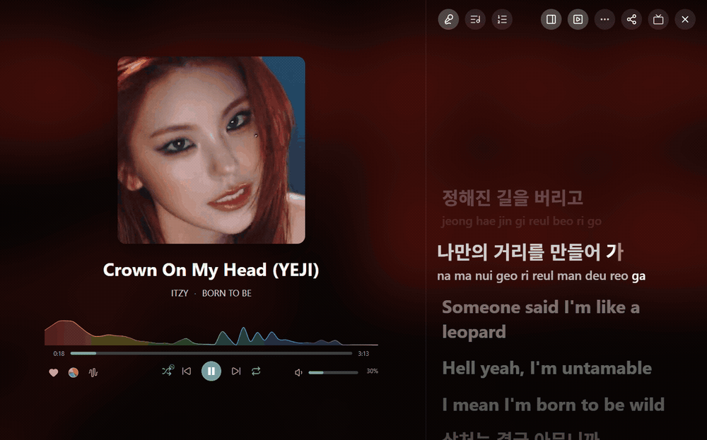
</p>

## 安装

从[最新版本](https://github.com/InstaZDLL/WaveFlow/releases/latest)下载适合你系统的安装包。每个版本页面都列出了各包管理器（AUR、COPR、apt、winget）的一行安装命令，以及 Windows、macOS 和 Linux 的独立安装程序。已安装的版本会自动更新，也可以在设置中开启测试版通道。

在 macOS 上，一条命令即可下载最新版本、完成校验并安装到 `/Applications`：

```sh
curl -fsSL https://waveflow.app/install.sh | bash
```

WaveFlow 尚未经过 Apple 公证，因此 macOS 会拒绝打开通过浏览器下载的副本。该脚本只移除 WaveFlow.app 的隔离标记，不更改任何系统设置；`--help` 列出全部选项（`--beta`、`--user`、`--uninstall` 等）。脚本位于 [`scripts/install-macos.sh`](scripts/install-macos.sh)，运行前可先阅读。

## 功能

每个领域的要点；点击标题即可查看完整说明（英文）。

### 🎧 [播放](docs/features/playback.md)

- MP3、FLAC、WAV、AIFF、Ogg Vorbis、Opus、AAC（含 HE-AAC）、ALAC、WavPack、Monkey's Audio 和 DSD
- 无缝播放，交叉淡入淡出可选固定时长、按专辑判断、按速度调整，或踩准节拍的 **AutoMix**
- **独占输出**与 **DSD over PCM**，**5.1 / 7.1** 声道按正确的扬声器播放，或缩混为你现有的声道
- ReplayGain、6 段均衡器、可选择是否保持音调的变速、移调、A-B 循环、睡眠定时器

### 🎤 [歌词](docs/features/integrations.md)

- 同步歌词来自 LRCLIB 和其他歌词源，也可来自[插件](#扩展-waveflow)，或曲目旁的 `.lrc` / `.ttml` 文件
- 逐字时间轴；歌词源只有逐行时间时自动估算
- 日语、韩语和中文的罗马音标注，原文旁并排显示翻译

### 📚 [曲库](docs/features/library.md)

- 扫描文件夹并实时监控变化，**WebDAV 与 SMB 共享**也能作为曲库文件夹读取
- 按专辑、艺人、流派、年份或文件夹浏览；中文标题支持拼音搜索
- 能识破冒充无损文件的**音质**标签页、重复项、专辑完整度，还能用更好的版本替换文件，而不丢失其播放次数、收藏和歌单

### 🏷️ [标签与信息补全](docs/features/enrichment.md)

- **MusicBrainz** 为你的曲库补全流派、日期、署名和封面——经过确认、可以撤销，绝不写入你的文件
- 适用于选中项、整张专辑或整个文件夹的[**标签工坊**](docs/features/tag-workshop.md)：填充、查找替换（支持正则）、大小写、编号，带逐字段预览和撤销

### 🎶 [歌单](docs/features/playlists.md)

- 基于规则构建的[智能歌单](docs/features/smart-playlists.md)，实时显示数量
- 根据你的收听生成的 **Daily Mix** 与 **On Repeat**，以及追踪你的艺人新发行的 **Release Radar**
- 可从 M3U、CSV、JSON 或公开的 Deezer 链接导入——你还没有的曲目会保留位置

### 🎙️ [播客](docs/features/podcasts.md)

- 需手动开启，并与你的音乐分开：订阅、OPML、定时刷新、在空间上限内下载
- 从上次停下的地方继续，每个节目沿用自己的播放速度，支持章节与文字稿

### 🎨 [界面](docs/features/ui.md)

- 六种皮肤与十四种主题，强调色可自选，也可取自封面
- 沉浸视图、始终置顶的迷你播放器、悬浮桌面歌词、系统托盘
- 统计数据与 **WaveFlow Wrapped**，全部在你的电脑上计算；17 种语言，含从右到左的语言

### 🔌 [连接](docs/features/integrations.md)

- Last.fm scrobble、Discord 动态状态，封面和艺人简介只获取一次并缓存
- 可选的 [DLNA / UPnP](docs/features/dlna.md) 与 [MPD](docs/features/mpd.md) 服务器，供你已在使用的客户端连接
- 你自己的 [WaveFlow Server](#waveflow-家族) 可作为第二音乐来源，并在设备间同步
- 一个开关即可切断全部网络访问

## 扩展 WaveFlow

插件是运行在沙箱中的小型 WebAssembly 模块，只拥有它们申请的权限。WaveFlow 内置的商店一键安装插件，并用[插件目录](https://github.com/InstaZDLL/waveflow-plugins)固定的指纹校验每一次下载。

<table>
  <tr>
    <td width="50%" valign="top">
      <b>📻 Web Radio</b> · <i>内置</i>
      <br />
      30 000+ 个电台，可按国家、语言或流派浏览；直播流带 30 分钟暂停缓冲，支持 HLS，还能添加你自己的电台。
    </td>
    <td width="50%" valign="top">
      <b>🎤 逐字同步歌词</b> · <i>五个来源</i>
      <br />
      更多带逐字时间轴的歌词库，支持和声与对唱、翻译和罗马音——尤其擅长中文、日语和韩语音乐。
    </td>
  </tr>
  <tr>
    <td width="50%" valign="top">
      <b>🎞️ 让正在播放动起来</b> · <i>三个来源</i>
      <br />
      循环播放的 Canvas 短片和动态专辑封面，在沉浸视图和侧边面板中衬在曲目背后。
    </td>
    <td width="50%" valign="top">
      <b>🛠️ 自己动手</b>
      <br />
      可编写四类插件：音乐来源、元数据与歌词、独立页面、Canvas 短片。任何能构建 WebAssembly 组件的语言都可以。
    </td>
  </tr>
</table>

<p align="center">
  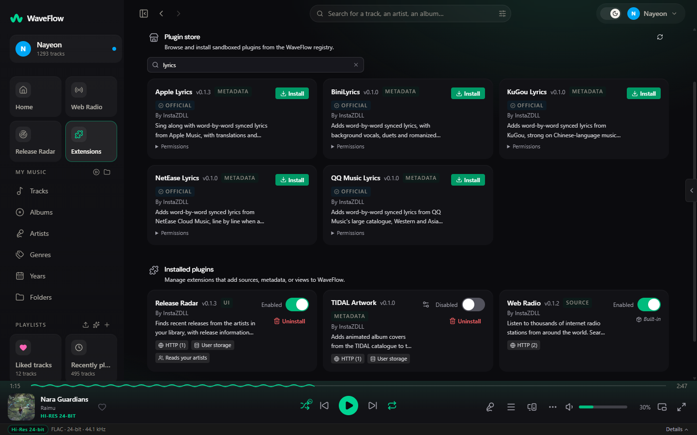
  <br />
  <sub>想写一个插件？从<a href="docs/features/plugins.md">插件指南</a>和 <a href="docs/rfcs/RFC-002-plugin-sdk.md">RFC-002</a> 开始（英文）。</sub>
</p>

## 截图

<table>
  <tr>
    <td width="50%">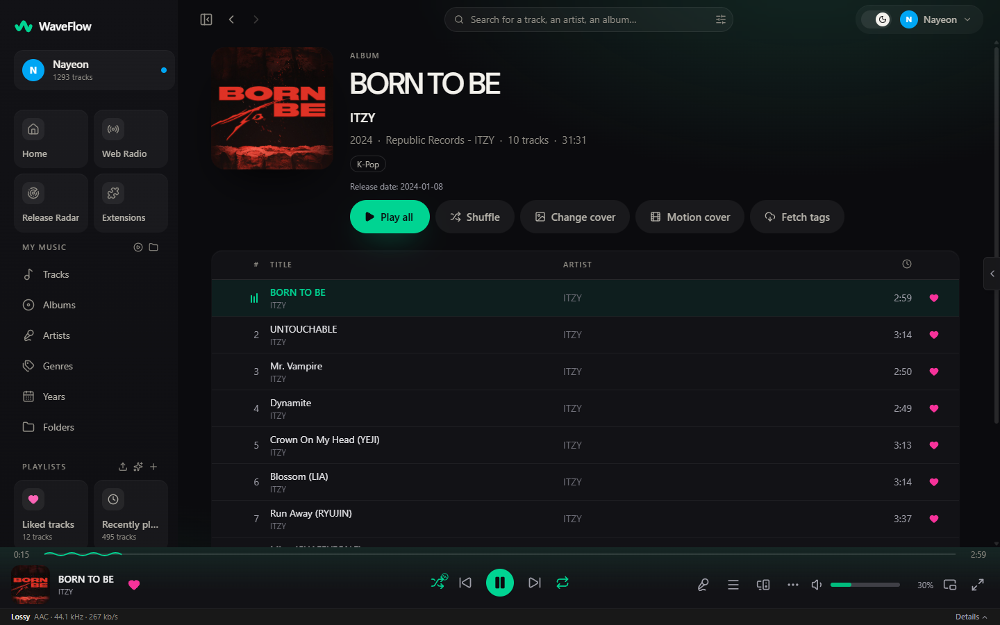</td>
    <td width="50%">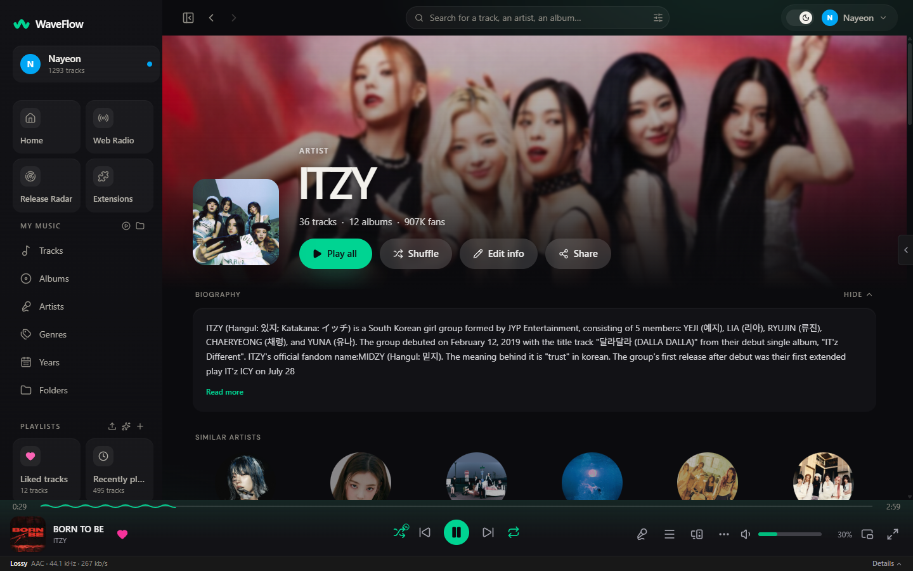</td>
  </tr>
  <tr>
    <td align="center"><sub><b>专辑</b> · 正在播放的曲目，播放栏中显示 Hi-Res 音质</sub></td>
    <td align="center"><sub><b>艺人</b> · 横幅、简介、相似艺人</sub></td>
  </tr>
  <tr>
    <td width="50%">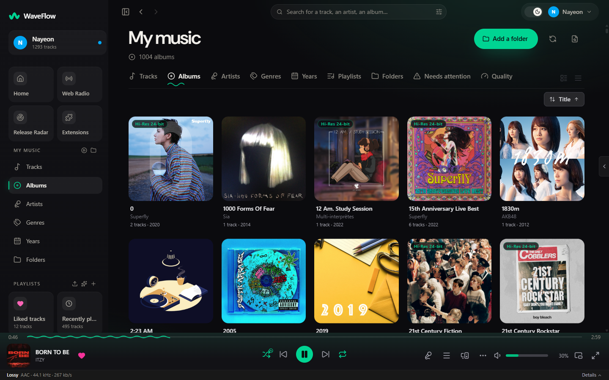</td>
    <td width="50%">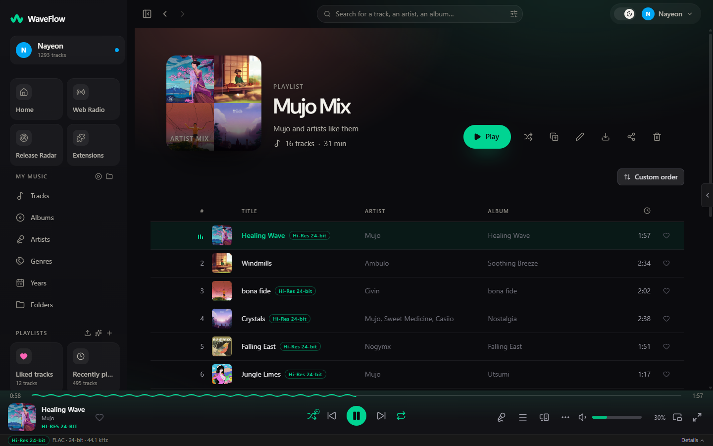</td>
  </tr>
  <tr>
    <td align="center"><sub><b>曲库</b> · 专辑、艺人、流派、年份、文件夹、音质</sub></td>
    <td align="center"><sub><b>智能歌单</b> · 根据你的收听生成</sub></td>
  </tr>
  <tr>
    <td width="50%">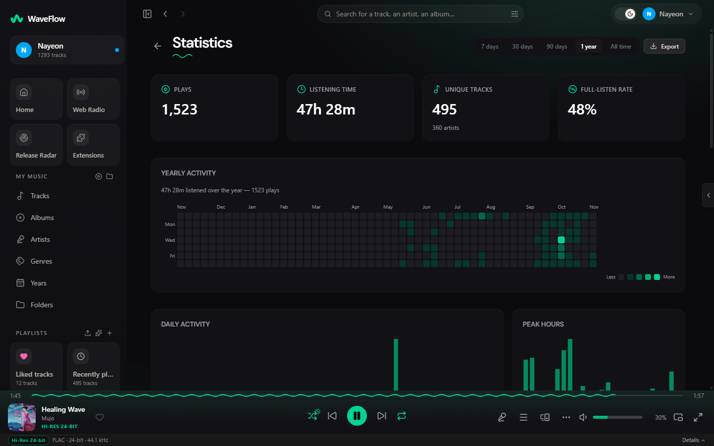</td>
    <td width="50%">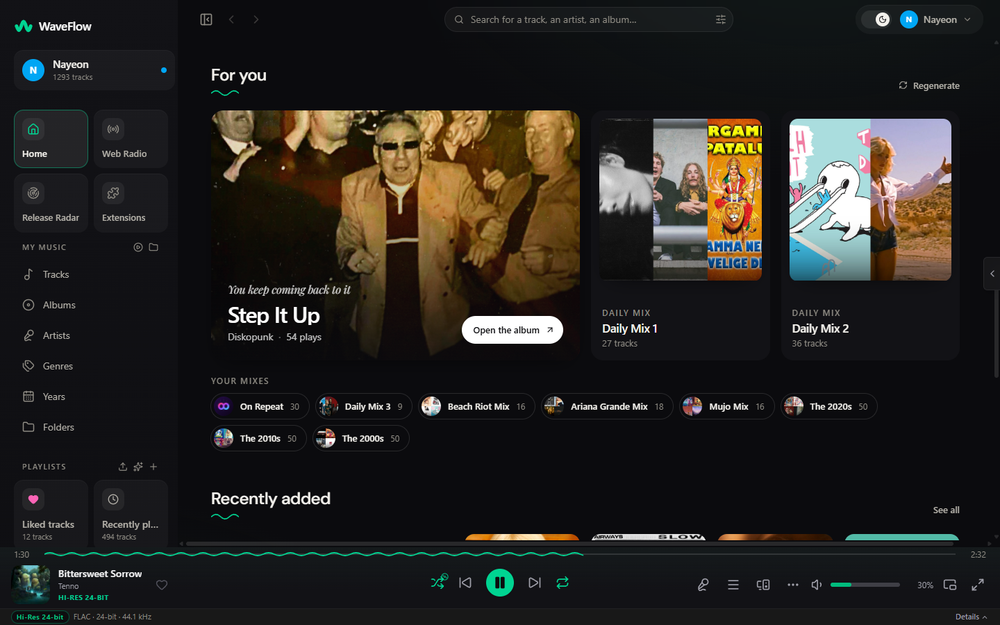</td>
  </tr>
  <tr>
    <td align="center"><sub><b>统计</b> · 全部在你的电脑上计算</sub></td>
    <td align="center"><sub><b>为你推荐</b> · Daily Mix、On Repeat、你自己的混合歌单</sub></td>
  </tr>
</table>

### 播放器之外

<table>
  <tr>
    <td width="50%" align="center"></td>
    <td width="50%" align="center">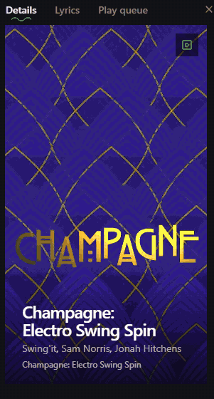</td>
  </tr>
  <tr>
    <td align="center"><sub><b>迷你播放器</b> · 始终置顶，逐字同步歌词</sub></td>
    <td align="center"><sub><b>正在播放</b> · 用 Canvas 短片取代封面</sub></td>
  </tr>
  <tr>
    <td width="50%">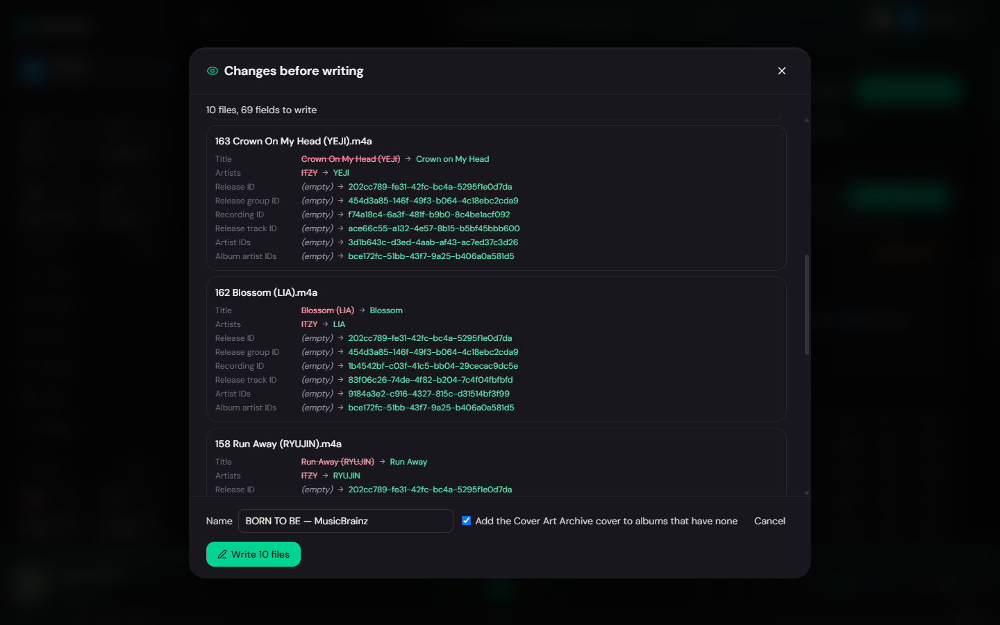</td>
    <td width="50%">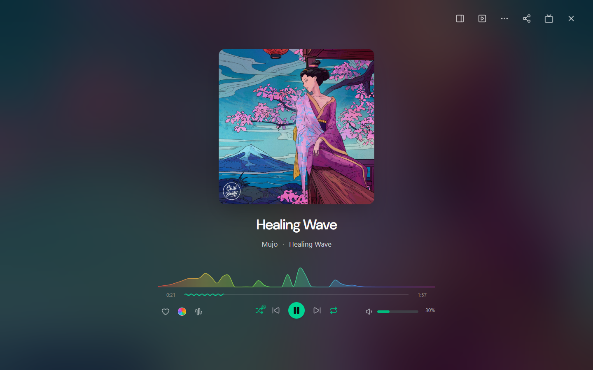</td>
  </tr>
  <tr>
    <td align="center"><sub><b>标签工坊</b> · 每处修改都可预览、都可撤销</sub></td>
    <td align="center"><sub><b>沉浸视图</b> · 封面与实时频谱</sub></td>
  </tr>
</table>

### 六种皮肤

不是六套配色，而是六种布局，各有自己的字体、质感与动效。同一页面、同一时刻，在每一种皮肤下的样子。

<p align="center">
  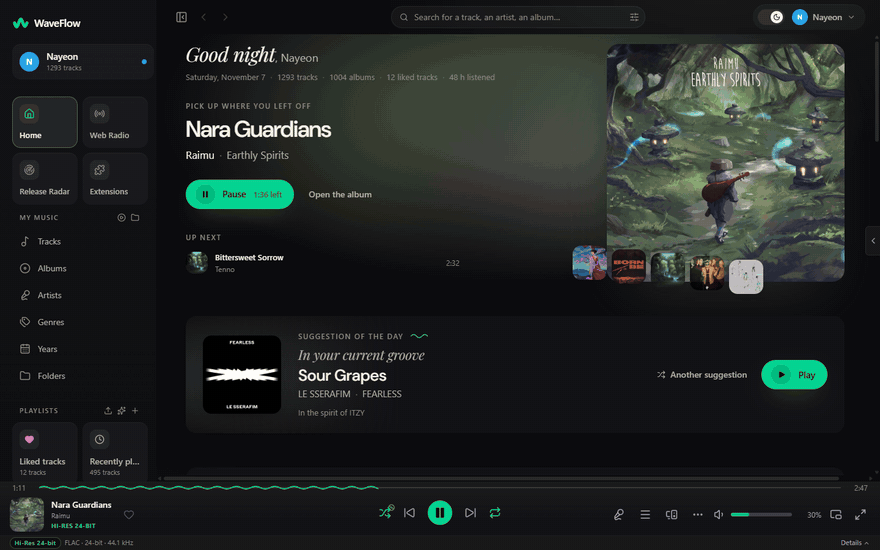
</p>

<table>
  <tr>
    <td width="33%">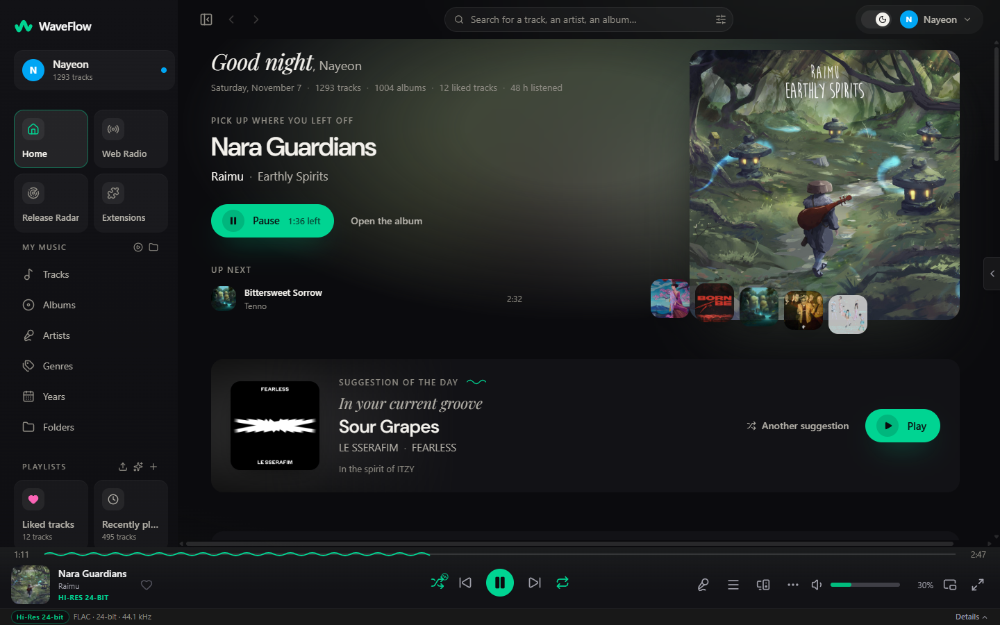</td>
    <td width="33%">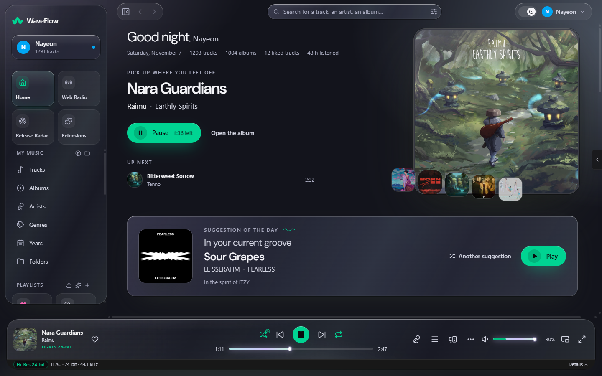</td>
    <td width="33%">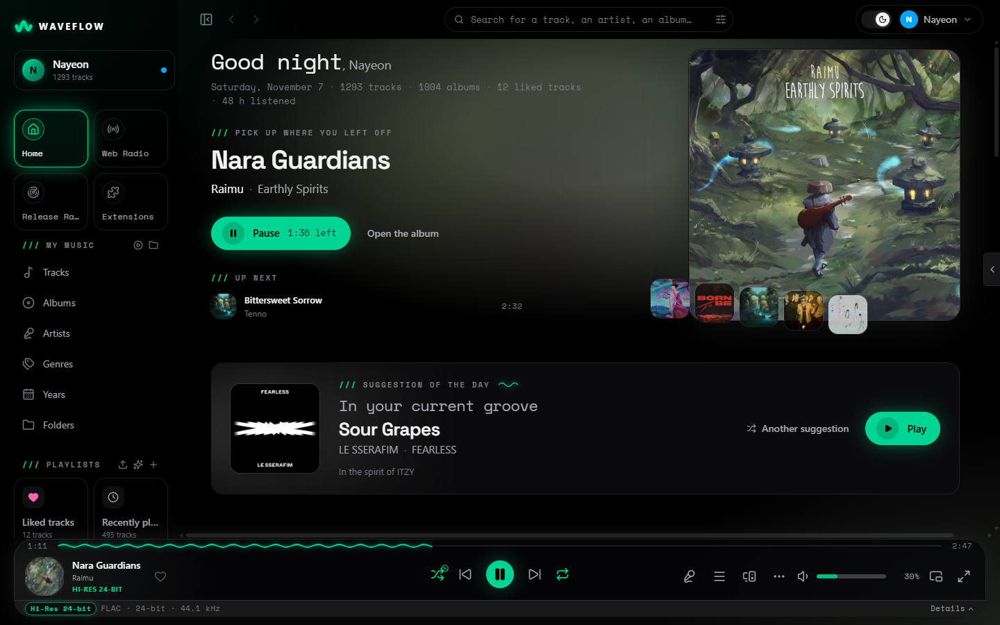</td>
  </tr>
  <tr>
    <td align="center"><sub><b>Fluid</b> · 默认</sub></td>
    <td align="center"><sub><b>Liquid</b> · 极光玻璃</sub></td>
    <td align="center"><sub><b>Pulse</b> · 霓虹控制台</sub></td>
  </tr>
  <tr>
    <td width="33%">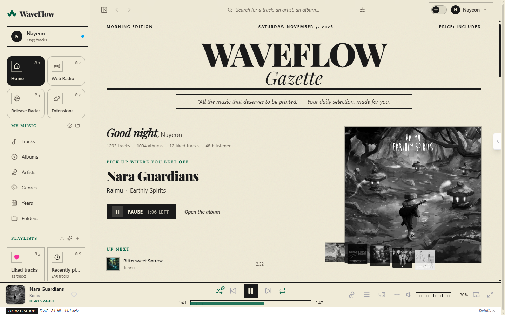</td>
    <td width="33%">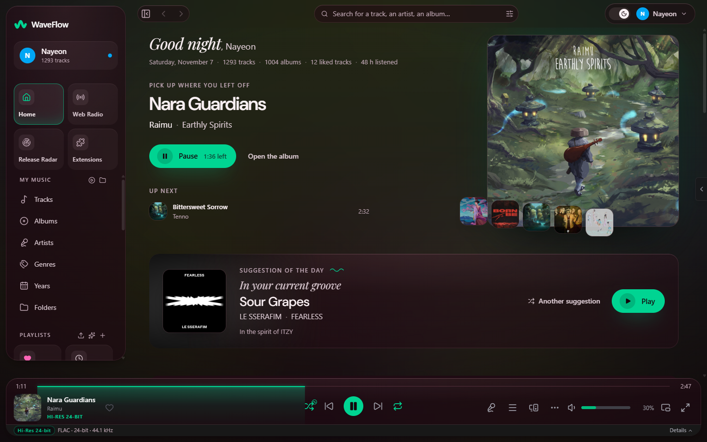</td>
    <td width="33%">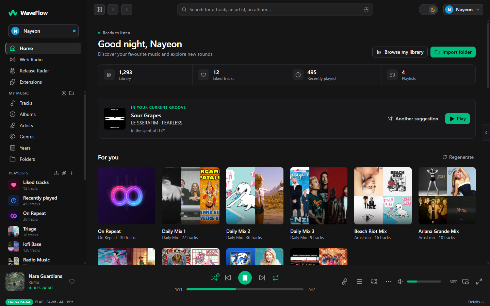</td>
  </tr>
  <tr>
    <td align="center"><sub><b>Editorial</b> · 纸上的大报</sub></td>
    <td align="center"><sub><b>Lounge</b> · 聆听室</sub></td>
    <td align="center"><sub><b>Studio</b> · 经典布局</sub></td>
  </tr>
</table>

<p align="center"><sub><i>截图中的专辑封面来自维护者本人的曲库，版权归各自的权利人所有。WaveFlow 不附带、也不分发任何音乐。</i></sub></p>

## WaveFlow 家族

WaveFlow 是一个小型应用家族的核心，这些应用都免费开源，共享它的引擎与外观。

<table>
  <tr>
    <td width="50%" valign="top">
      <a href="https://github.com/InstaZDLL/waveflow-server"></a>
      <br />
      <b><a href="https://github.com/InstaZDLL/waveflow-server">🌐 WaveFlow Server</a></b>
      <br />
      <i>你的音乐，随处可听。</i>以单个 Rust 可执行文件提供的自托管音乐服务器，内置网页播放器，并支持你手机上的应用早已在用的 OpenSubsonic API。让 WaveFlow 连接它，它的曲库便会并入你的曲库；收藏、评分和歌单在设备之间同步。
      <br />
      <a href="https://github.com/InstaZDLL/waveflow-server#install"><b>安装服务器 →</b></a>
    </td>
    <td width="50%" valign="top">
      <a href="https://github.com/InstaZDLL/waveflow-quickplay"></a>
      <br />
      <b><a href="https://github.com/InstaZDLL/waveflow-quickplay">⚡ WaveFlow QuickPlay</a></b>
      <br />
      <i>双击，即听。</i>一款为眼前这个文件而生的小巧原生播放器：从文件管理器打开不到 300 毫秒即可就绪，无需扫描曲库。与 WaveFlow 使用相同的解码器——FLAC、Opus、DSD 等等——支持同步歌词、封面和播放列表。
      <br />
      <a href="https://github.com/InstaZDLL/waveflow-quickplay/releases/latest"><b>下载 QuickPlay →</b></a>
    </td>
  </tr>
</table>

- **[WaveFlow for Android](https://github.com/InstaZDLL/waveflow-android)**——原生移动客户端，开发中。
- **[waveflow-plugins](https://github.com/InstaZDLL/waveflow-plugins)**——应用内插件商店读取的精选插件目录。

## 开发

需要 Bun、Rust 以及[开发者指南（英文）](docs/CONTRIBUTING.md#requirements)中列出的平台依赖。

```bash
bun install            # 安装依赖
bun run tauri dev      # 以开发模式运行桌面应用
bun run tauri build    # 构建正式安装包

bun run dev            # 仅启动 Vite 开发服务器（不含 Tauri 外壳）
bun run typecheck      # TypeScript 检查
bun run lint           # ESLint
bun run format         # Prettier

# Rust 后端
cargo fmt   --manifest-path src-tauri/Cargo.toml --all -- --check   # CI 首先运行这一步
cargo check --manifest-path src-tauri/Cargo.toml --workspace --all-targets
cargo test  --manifest-path src-tauri/Cargo.toml --workspace
```

**技术栈**——Tauri 2 · Rust · SQLite（sqlx、FTS5）· tokio · React 19 · TypeScript · Vite · Tailwind CSS 4 · Framer Motion · symphonia + libopus + rusty_aac（解码）· cpal（输出）· rubato（重采样）· rtrb（无锁环形缓冲区）· realfft（频谱）· lofty（标签）· wasmtime + WASI p2（插件）。

## 文档

各功能的详细说明、架构与存储结构都在 [`docs/`](docs/README.md) 下（英文）：

- **功能**——[播放](docs/features/playback.md) · [曲库](docs/features/library.md) · [信息补全](docs/features/enrichment.md) · [标签工坊](docs/features/tag-workshop.md) · [歌单](docs/features/playlists.md) · [智能歌单](docs/features/smart-playlists.md) · [播客](docs/features/podcasts.md) · [集成](docs/features/integrations.md) · [插件](docs/features/plugins.md) · [DLNA / UPnP](docs/features/dlna.md) · [MPD](docs/features/mpd.md) · [界面与体验](docs/features/ui.md)
- **设计**——[Fluid Editorial](docs/design/fluid-editorial.md) · [Liquid](docs/design/liquid-aurora-glass.md) · [Pulse](docs/design/pulse-neon-deck.md) · [Editorial](docs/design/editorial-broadsheet.md) · [Lounge](docs/design/lounge-listening-room.md) · [Studio](docs/design/studio-refined.md)
- **架构**——[跨模块约定](docs/architecture/invariants.md) · [crate 结构](docs/architecture/crates.md) · [音频引擎](docs/architecture/audio.md) · [数据库与路径](docs/architecture/storage.md)
- **参与贡献**——[CONTRIBUTING.md](CONTRIBUTING.md) · [开发者指南](docs/CONTRIBUTING.md) · [RELEASING.md](docs/RELEASING.md)

## 社区

- 🐛 **发现 Bug？** → [提交 Bug 报告](https://github.com/InstaZDLL/WaveFlow/issues/new?template=bug_report_zh-CN.yml)
- ✨ **有新想法？** → [Discussions › Ideas](https://github.com/InstaZDLL/WaveFlow/discussions/categories/ideas)（先讨论，想法成形后再转为[功能请求](https://github.com/InstaZDLL/WaveFlow/issues/new?template=feature_request.yml)）
- 🙏 **安装或使用求助？** → [Discussions › Q&A](https://github.com/InstaZDLL/WaveFlow/discussions/categories/q-a)
- 🙌 **想展示你的配置或歌单？** → [Discussions › Show and tell](https://github.com/InstaZDLL/WaveFlow/discussions/categories/show-and-tell)
- 🔒 **安全问题？** → [私下披露](.github/SECURITY.md)——请勿公开发布漏洞。

🌍 **欢迎使用任何语言。** 用你最顺手的语言写就好——中文、English、Français、Español、العربية 或其他任何语言，我们都会回复你。

## 隐私

WaveFlow 没有账号、没有遥测、也没有统计分析：你的曲库、收听记录和设置都保存在你的电脑上。部分功能会访问在线服务——封面、歌词、检查更新——[PRIVACY.md](PRIVACY.md)（英文）逐一列出了它们发送的内容以及关闭方法。只需一个开关——**离线模式**——即可一次性切断这些在线查询；PRIVACY.md 也说明了它不会关闭的部分。

## 代码签名政策

- 每个版本都由 GitHub Actions 从本仓库带标签的提交构建（[`release.yml`](.github/workflows/release.yml)），不会在个人电脑上构建任何发布用的二进制文件。
- 构建流程及其脚本都公开保存在本仓库中。
- 提交者与审核者：[InstaZDLL](https://github.com/InstaZDLL)。每个版本的批准者：[InstaZDLL](https://github.com/InstaZDLL)，在发布前人工批准。
- 应用通过网络发送的内容详见 [PRIVACY.md](PRIVACY.md)。

## 许可证

本程序以 **GPL-3.0-only** 许可发布。以下为英文原文的许可声明，以原文为准：

```
Copyright (C) 2026 InstaZDLL

This program is free software: you can redistribute it and/or modify
it under the terms of the GNU General Public License as published by
the Free Software Foundation, version 3 of the License only.

This program is distributed in the hope that it will be useful,
but WITHOUT ANY WARRANTY; without even the implied warranty of
MERCHANTABILITY or FITNESS FOR A PARTICULAR PURPOSE. See the
GNU General Public License for more details.

You should have received a copy of the GNU General Public License
along with this program. If not, see <https://www.gnu.org/licenses/>.
```

完整条款见 [LICENSE](LICENSE)，第三方声明见 [THIRD_PARTY_NOTICES.md](THIRD_PARTY_NOTICES.md)。

### 商标

WaveFlow 的标志（[`assets/`](assets/) 下的文件以及应用图标）是 InstaZDLL 的商标。GPL-3.0 许可证只涵盖代码，并不授予使用该标志的权利（GPL-3.0 第 7(e) 条）。

你可以使用该标志来指代 WaveFlow，例如在文章、评测、链接或演讲中；以未经修改、从本仓库构建的方式分发 WaveFlow 的软件包也可以保留它。分支版本或修改后的构建必须使用自己的图标，并且不得暗示其为官方版本或得到本项目的认可。
